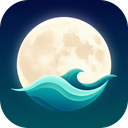
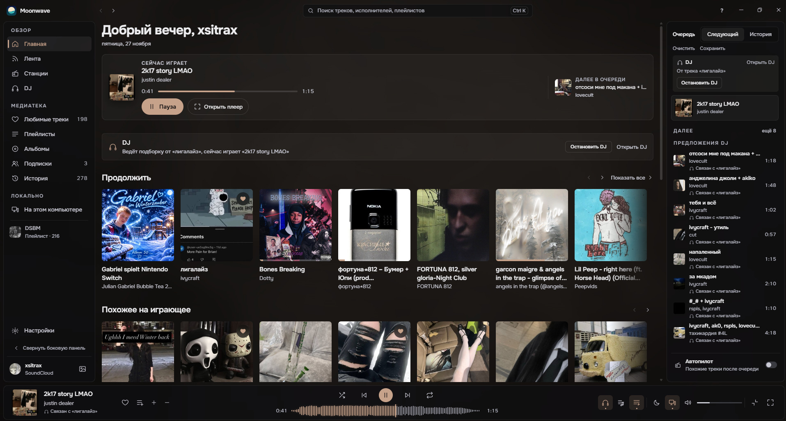
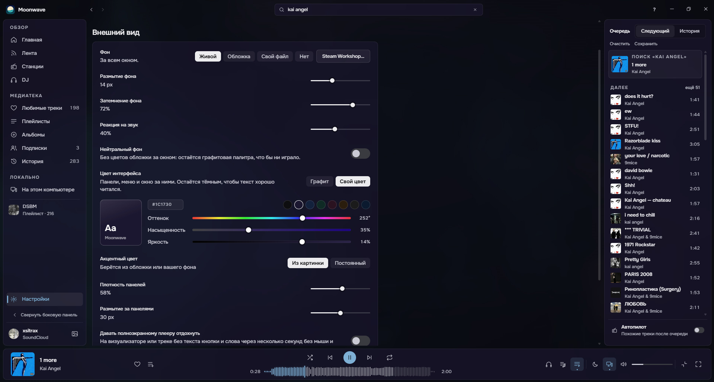

  

# Moonwave

**Неофициальный плеер SoundCloud для Windows, macOS и Linux.**

Слушайте музыку без рекламы, подпевайте по синхронизированным текстам и настройте плеер под себя.

[Как установить](#как-установить) · [Что умеет](#что-умеет-moonwave) · [Если что-то не работает](#если-что-то-не-работает) · [English](#english)

## Как установить

Откройте [последний релиз](https://github.com/xsitraxs/Moonwave/releases/latest), найдите раздел **Assets** и выберите файл для своей системы:

| Система | Что скачать и как запустить |
| --- | --- |
| **Windows 10 / 11** | `moonwave-setup-….exe` — установщик, `moonwave-portable-….exe` — версия без установки. |
| **macOS 13 и новее** | `.dmg` с `arm64` для Apple Silicon (M1 и новее) или `x64` для Intel. Откройте образ и перетащите Moonwave в **Программы**. |
| **Linux** | `x86_64.AppImage` — сделайте файл исполняемым и запустите. Для Debian / Ubuntu можно выбрать `amd64.deb` и установить через `sudo apt install ./moonwave-*.deb`. |

Сборки Windows и macOS не подписаны. Если система блокирует запуск, сначала убедитесь, что файл скачан с официальной страницы релиза Moonwave. Затем на Windows выберите **Подробнее → Выполнить в любом случае**, а на macOS — **Системные настройки → Конфиденциальность и безопасность → Всё равно открыть**. [Как проверить скачанный файл](docs/guide.md#проверка-релиза).

**Можно сразу слушать:** без аккаунта доступны поиск, воспроизведение и локальные плейлисты. Нажмите **Войти**, чтобы увидеть свои лайки и плейлисты SoundCloud.

## Что умеет Moonwave

- **Собирайте музыку в одном месте.** Открывайте лайки, плейлисты и профили SoundCloud, добавляйте файлы с компьютера или переносите плейлисты из Spotify, Яндекс Музыки, YouTube Music и VK Музыки: Moonwave подберёт совпадения на SoundCloud.
- **Подпевайте.** Синхронизированные строки подсвечиваются во время песни; по нажатию на строку можно перемотать трек. Есть полноэкранный режим с обложкой и визуализацией.
- **Настройте звук и очередь.** Кроссфейд, 10-полосный эквалайзер, таймер сна и автоподбор похожих треков, когда очередь закончится.
- **Настройте внешний вид.** Выберите свой акцент и фон: обложку, картинку, GIF или видео. Можно показывать текущий трек в Discord.

| Полноэкранный плеер | Настройки оформления |
| --- | --- |
|  |  |

## Если что-то не работает

- **Не открывается SoundCloud?** Проверьте, открывается ли `soundcloud.com` в браузере. Официальные сборки используют ваше подключение и не содержат встроенного прокси. [Подробнее о подключении](docs/guide.md#полезно-знать).
- **Не получается войти?** В окне входа выберите **Войти через браузер**.
- **У трека метка `SoundCloud only`?** Этот трек можно открыть на сайте SoundCloud, но Moonwave не может его воспроизвести.
- **Где мои локальные плейлисты на другом ПК?** Они хранятся на компьютере, а не в аккаунте. Перенесите их файлом через **Плейлисты → Экспорт**.
- **Нужна помощь?** В приложении откройте **Настройки → О программе → Сообщить о проблеме** или [создайте issue](https://github.com/xsitraxs/Moonwave/issues).

[Руководство](docs/guide.md) · [Переход с sc player](docs/guide.md#переход-с-sc-player) · [Разработка](docs/development.md) · [Авторы и лицензия](docs/credits.md)

## English

Moonwave is an unofficial SoundCloud desktop player with synced lyrics, custom backgrounds, local playlists and audio files, a 10-band EQ, and crossfade. You can search and listen without signing in. Sign in for your SoundCloud likes and playlists.

Open **Assets** in the [latest release](https://github.com/xsitraxs/Moonwave/releases/latest):

- **Windows 10 / 11:** choose the setup or portable `.exe`. If SmartScreen warns, verify that you downloaded it from the official Moonwave release page before choosing **More info → Run anyway**.
- **macOS 13+:** choose the `arm64` DMG for Apple Silicon or `x64` for Intel. Drag Moonwave into Applications. The app isn't signed or notarized; if blocked, verify the source before choosing **System Settings → Privacy & Security → Open Anyway**.
- **Linux:** make the `x86_64.AppImage` executable and run it, or install the `amd64.deb` on Debian / Ubuntu.

If sign-in fails, choose **Sign in with browser**. SoundCloud must be reachable on your network; official builds have no built-in proxy. For help, [open an issue](https://github.com/xsitraxs/Moonwave/issues).

Moonwave is a modified version of [sc player](https://github.com/waterlilo/sc-player) by waterlil, distributed under [GPL-3.0](LICENSE). It is not affiliated with SoundCloud or endorsed by waterlil.
