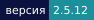
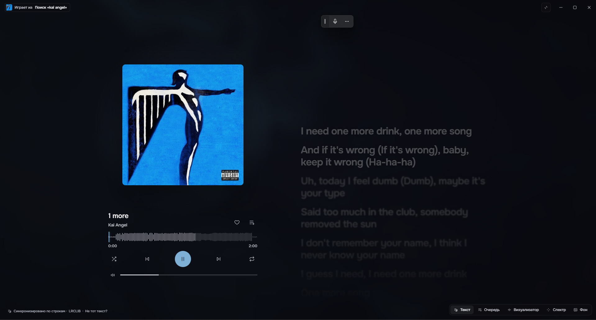

<div align="center">


# Moonwave

**Плеер SoundCloud для Windows, macOS и Linux: без рекламы, с текстами песен и своим оформлением.**

<sub>Основан на [sc player](https://github.com/waterlilo/sc-player) от waterlil · не связан с ним · [English below](#english)</sub>

<br/>

<a href="https://github.com/xsitraxs/Moonwave/releases/latest"></a>
<a href="https://github.com/xsitraxs/Moonwave/releases/tag/v2.6.0"></a>


<a href="LICENSE"></a>

[Возможности](#возможности) •
[Установка](#установка) •
[Переход с sc player](#переход-с-sc-player) •
[Полезно знать](#полезно-знать) •
[Скоро](#скоро) •
[Разработка](#разработка)

<br/>


</div>

<table>
  <tr>
    <td align="center" width="50%">
      
      <br/>
      <sub><b>Полноэкранный плеер с текстом</b></sub>
    </td>
    <td align="center" width="50%">
      
      <br/>
      <sub><b>Свой цвет, фон и стекло</b></sub>
    </td>
  </tr>
</table>

> [!NOTE]
> Moonwave — неофициальное приложение, SoundCloud его не делал и не поддерживает. Оно работает через тот же интерфейс,
> что и soundcloud.com, поэтому SoundCloud должен открываться в вашей сети (в России — через zapret или VPN, см.
> [Полезно знать](#полезно-знать)).

---

## Возможности

**Музыка**
- Лайки, плейлисты, альбомы, станции, история, лента подписок, любой открытый профиль. Плейлисты и профили можно
  закрепить в боковой панели.
- **Подписки на артистов прямо из приложения** — кнопка на профиле, странице трека и в меню трека. Отписаться можно в
  один клик; подписка оформляется на SoundCloud в окне приложения, после чего Moonwave сам обновит кнопку, счётчик и
  список «Подписки».
- **Свои плейлисты** — создавайте, переставляйте, переименовывайте. Хранятся на компьютере и работают даже без входа.
  Любой плейлист SoundCloud можно скопировать к себе, очередь — сохранить, всё — выгрузить в файл и загрузить обратно.
- **Перенос плейлистов** из Spotify, Яндекс Музыки, YouTube Music и VK Музыки (или просто списка строк): вставьте
  ссылку, и каждый трек найдётся на SoundCloud.
- **Честное перемешивание** по всему плейлисту или всем лайкам, **автопилот** — похожие треки после очереди.
- **Защищённые треки:** если SoundCloud отдаёт трек только с DRM или 30-секундным отрывком, Moonwave включает другую
  загрузку той же записи, сверив её по звуку (метка `ALT`).
- Перемотка по волне, очередь с перетаскиванием, кроссфейд, 10-полосный эквалайзер, выбор устройства вывода, таймер сна.
- **Музыка с компьютера:** свои файлы прямо рядом с треками SoundCloud.

**Тексты песен**
- Из [Better Lyrics](https://betterlyrics.org) (часто с разметкой по словам), его каталога Unison и
  [LRCLIB](https://lrclib.net). Нажмите на строку — песня перемотается туда.
- Текст без таймингов можно подогнать под песню прямо на компьютере (Настройки → Тексты): модель
  распознавания речи скачивается по желанию, звук никуда не отправляется.
- **Полноэкранный плеер:** большая обложка, спектр вокруг неё или внизу и слова, которые загораются по мере пения.

**Оформление**
- **Обои из Steam Workshop** — вставьте ссылку на обои [Wallpaper Engine](https://store.steampowered.com/app/431960/Wallpaper_Engine/) в Настройки → Внешний вид → «Обои из Steam Workshop», и они станут вашим фоном: видео — сделанной копией в 2K, сцены и веб-обои — по своему превью (GIF-превью анимируется). Нужны Steam и установленный Wallpaper Engine; обои скачиваются через Steam с подписки на них.
- Тёмное стекло поверх живого фона в цветах обложки — или сама обложка, ваша картинка, GIF или видео.
- Свой цвет интерфейса и акцент, размытие, затемнение, плотность панелей; облегчённые эффекты для слабых ПК.

**На компьютере**
- Медиаклавиши, системные элементы управления, значок в трее и в строке меню, глобальные горячие клавиши,
  уведомления, автозапуск.
- **Статус в Discord:** трек, обложка и время в вашем профиле, пока что-то играет. В коротком статусе можно показывать
  «Слушает Moonwave», исполнителя или название трека. Передаётся приложению Discord на этом же компьютере, без
  сервера. Настраивается в Настройки → Окно и система.
- **Windows:** кнопки ⏮ ⏯ ⏭ под превью на панели задач. **macOS:** закрытие окна не останавливает музыку.
- Обновляется сам (установщик Windows, AppImage на Linux) или сообщает о новой версии (macOS, .deb, portable).
  Пока окно скрыто, ничего не рисуется — играет только звук.

### Чем отличается от sc player
- Своё имя, иконка и свои обновления из этого репозитория.
- На Windows 11 версии 26200 и новее Chromium запускает аудио без `AudioServiceSandbox`; после сбоя `0x80000003`
  приложение также отключает эту песочницу при следующем запуске, а при повторном сбое может отключить GPU-песочницу.
  Renderer-песочница остаётся включена. Это компромисс ради запуска и звука; см. журнал приложения при диагностике.
- Усиленная защита: разрешения страниц по белому списку, Electron fuses и проверка целостности ASAR, вход через
  браузер с проверкой состояния, `SHA256SUMS.txt` и подтверждение происхождения у каждого релиза.
- Счётчики использования по умолчанию выключены.

---

## Установка

### Windows
1. Скачайте `moonwave-setup-v….exe` (установщик) или `moonwave-portable-v….exe` (без установки) из
   [последнего релиза](../../releases/latest).
2. Приложение не подписано сертификатом, поэтому Windows может показать «Система Windows защитила ваш компьютер»:
   нажмите **Подробнее → Выполнить в любом случае**.

### macOS
Нужна **macOS 13 Ventura или новее**.

1. Скачайте `moonwave-v…-arm64.dmg` (Apple Silicon: M1 и новее) или `moonwave-v…-x64.dmg` (Intel) из
   [последнего релиза](../../releases/latest).
2. Откройте `.dmg` и перетащите **Moonwave** в **Программы**.
3. Приложение не подписано и не нотариализовано Apple. Если macOS заблокирует запуск, используйте **Системные
   настройки → Конфиденциальность и безопасность → Всё равно открыть**. Не запускайте `xattr -cr`: эта команда
   удаляет все расширенные атрибуты приложения, включая карантинную метку Gatekeeper.
4. Подгонка текстов под песню работает только на Apple Silicon; всё остальное — и на Intel.

### Linux
- **AppImage** (любой дистрибутив): скачайте `moonwave-v…-x86_64.AppImage`, сделайте исполняемым
  (`chmod +x moonwave-*.AppImage`) и запустите. Он сам добавится в меню приложений и будет обновляться.
- **Debian / Ubuntu:** скачайте `moonwave-v…-amd64.deb` и установите (`sudo apt install ./moonwave-*.deb`).
- В GNOME для значка в трее нужно расширение AppIndicator.

### Проверка релиза
Скачайте все файлы из `SHA256SUMS.txt` и сам этот файл в одну папку, затем выполните `sha256sum -c SHA256SUMS.txt`
(на macOS: `shasum -a 256 -c SHA256SUMS.txt`). Для проверки происхождения установщика установите GitHub CLI и
выполните `gh attestation verify <имя-файла> -R xsitraxs/Moonwave`.

### Вход
Нажмите **Войти**, чтобы видеть свои лайки и плейлисты. Если окно входа пишет «доступ временно
ограничен» или «что-то пошло не так», выберите **Войти через браузер**. Без входа можно искать, слушать, делать свои
плейлисты и открывать любые профили.

Новые версии ставятся поверх старой: вход, настройки и плейлисты остаются.

> iPhone-версии у Moonwave нет.

---

## Переход с sc player

Moonwave ставится **отдельным приложением**, рядом со старым sc player.

- При первом запуске Moonwave **копирует** настройки, лайки, свои плейлисты, тексты и фоны из папки sc player. Старая
  папка не трогается, так что sc player продолжит работать, пока вы его не удалите.
- **Windows:** вход в SoundCloud переносится тоже.
- **macOS и Linux:** войдите в SoundCloud заново — системный ключ шифрования привязан к имени приложения.
- Закладку «Moonwave sign-in» для входа через браузер создайте заново, ссылки `scplayer://` больше не открываются.
- Файлы плейлистов, выгруженные из sc player, загружаются в Moonwave как есть.
- Когда убедились, что всё на месте, удалите sc player обычным способом.

---

## Полезно знать

- **SoundCloud в России.** Официальные сборки Moonwave не содержат встроенный прокси или адрес сервера проекта. В
  режиме «Авто» они используют системное подключение (например, ваш VPN или zapret); SoundCloud-трафик не идёт
  через сервер Moonwave. Сборки, сделанные кем-то с собственной конфигурацией прокси, могут работать иначе: если
  прямое подключение не удаётся, «Авто» направит SoundCloud-трафик через настроенный сервер. Работает с zapret или VPN; гайд сообщества:
  [«Как починить SoundCloud с помощью zapret»](https://github.com/Flowseal/zapret-discord-youtube/issues/7449)
  (от kkkwkswd).
- Некоторые треки SoundCloud отдаёт только в зашифрованном виде (DRM). Если другой загрузки той же записи нет, у трека
  будет пометка `SoundCloud only`, и он откроется на soundcloud.com.
- SoundCloud не пропускает запросы приложений на изменение подписок (у неё защита от ботов), поэтому «Подписаться» открывает страницу артиста в окне Moonwave: нажмите там Follow — и приложение само обновит кнопку, счётчик и список. Отписка из приложения проходит сразу. Это не баг и не обход защиты.
- Защита SoundCloud от ботов не даёт приложениям менять плейлисты на самом SoundCloud, поэтому свои плейлисты хранятся
  на компьютере. Время от времени выгружайте их в файл (Плейлисты → Экспорт): они не переезжают вместе с аккаунтом.
- Если SoundCloud что-то поменял у себя, приложение покажет ошибку с кнопкой **Повторить**; если не помогло — проверьте
  [новую версию](../../releases/latest).
- Что-то сломалось? Настройки → О программе → **Сообщить о проблеме** соберёт отчёт, или откройте
  [issue](../../issues).

---

## Скоро

Эти функции есть в исходном коде, но в официальных сборках скрыты: в них не задан сервер Moonwave. Можно собрать
приложение со своим сервером — см. [server/README.md](server/README.md).

- **Комнаты** — слушать с друзьями один трек в одну секунду.
- **Входящие** — коды друзей, отправка треков, что друзья слушают сейчас, ссылки-приглашения.
- **«Слушают в Moonwave»** на главной.
- **Мастерская** — публиковать своё оформление и ставить чужое.
- **Облачный бэкап** — лайки, плейлисты и тексты на новом компьютере по ключу переноса.
- **Встроенный прокси SoundCloud** — доступен только в сборках, которые владелец сам собрал с конфигурацией
  прокси; в официальных релизах его нет. В такой сборке режим «Встроенный» направляет трафик SoundCloud через
  заданный сервер, а режим «Авто» делает это только если прямое подключение недоступно.
- **Тексты от сообщества** — предлагать свои тексты для треков.

Как поднять свой сервер — в [server/README.md](server/README.md).

---

## Разработка

Нужен **Node.js 24 или новее** (`.nvmrc` закрепляет 24) и npm. Клонируйте репозиторий и поставьте зависимости:

```bash
git clone https://github.com/xsitraxs/Moonwave.git
cd Moonwave
npm install
```

| Команда | Что делает |
|---|---|
| `npm run dev` | запускает приложение с горячей перезагрузкой (нужен рабочий стол) |
| `npm test` | юнит-тесты приложения и скриптов: все `src/**/*.test.ts` и `scripts/**/*.test.mjs` |
| `npm run typecheck` | проверка типов main/preload (`tsconfig.node.json`) и renderer (`tsconfig.web.json`) |
| `npm run lint` | ESLint по всему репозиторию |
| `npm run build` | `typecheck` и сборка в `out/` через electron-vite (установщики — отдельно, `npm run dist`) |

**Сервер** (`server/api`) — отдельный проект без зависимостей, Node запускает его TypeScript сам:

```bash
cd server/api
DATA_DIR=./data-dev node src/main.ts     # API на http://127.0.0.1:8080
node test/smoke.ts                       # весь API по работающему серверу
node test/rooms-live.ts                  # комнаты прослушивания: поднимает и останавливает свой сервер
```

Из корня репозитория: `npm run test:server` (юнит-тесты сервера) и `npm run typecheck:server`. Подробности о
развёртывании, переменных окружения и модерации — в [server/README.md](server/README.md).

Перед pull request прогоните `npm test`, `npm run typecheck`, `npm run test:server`, `npm run typecheck:server` и
`npm run lint` — то же самое делает CI. Как устроен проект и что мы ждём от изменений — в
[CONTRIBUTING.md](CONTRIBUTING.md).

---

## Благодарности

- **[waterlil](https://github.com/waterlilo)** и участники [sc player](https://github.com/waterlilo/sc-player) —
  приложение, на котором построен Moonwave.
- **[Better Lyrics](https://betterlyrics.org)** — тексты из Better Lyrics и его каталога Unison (sc player использует их
  с разрешения автора), многие размечены по словам.
- **[LRCLIB](https://lrclib.net)** — открытая база текстов.
- **[Whisper](https://github.com/openai/whisper)** от OpenAI (MIT) — модель, которая подгоняет текст под песню.
- **[ggrk52](https://github.com/ggrk52)** — версия для macOS.
- **kkkwkswd** — гайд по zapret для SoundCloud.

---

## Лицензия

Copyright © 2026 waterlil and the contributors.

Moonwave — изменённая версия [sc player](https://github.com/waterlilo/sc-player) от waterlil, распространяется по
лицензии [GNU GPL v3.0](LICENSE). Форк сделан от sc player 2.3.0 и переименован 10 ноября 2026 года; все изменения
видны в истории этого репозитория. Программу можно использовать, изучать, менять и распространять, а изменённая версия
должна оставаться открытой под той же лицензией, вместе с исходным кодом.

Имя **sc player** и его логотип принадлежат оригинальному приложению и не входят в лицензию (GPL-3.0, раздел 7e),
поэтому Moonwave не использует ни то, ни другое. Moonwave не создан и не одобрен waterlil.

---

## English

**Moonwave** is a SoundCloud player for Windows, macOS and Linux — no ads, synced lyrics, your own look. It is a
modified version of [sc player](https://github.com/waterlilo/sc-player) by waterlil (GPL-3.0), not affiliated with it
or with SoundCloud.

- **Music:** likes, playlists, albums, stations, history, your feed; local playlists kept on your computer; import from
  Spotify, Yandex Music, YouTube Music and VK; honest shuffle and autopilot; DRM-only tracks replaced by another upload
  of the same recording; crossfade, 10-band EQ, output device, sleep timer; your own audio files; **follow the artists
  you like** from the profile, the track page and the track menu — unfollowing is one click, following happens on
  soundcloud.com in the app's own window and the app then updates the button, the counter and the followings list by
  itself.
- **Look:** dark glass over a living background, your own colour and accent; a full screen player with a spectrum;
  **Wallpaper Engine wallpapers from the Steam Workshop** as your background — video wallpapers come in a 2K copy,
  scenes and web wallpapers are set as their preview picture (an animated GIF preview plays), right from Settings →
  Appearance → "Wallpaper from Steam Workshop".
- **Lyrics** from Better Lyrics, Unison and LRCLIB, often word by word; plain lyrics can be synced on your computer.
- **Desktop:** media keys, tray, global hotkeys, notifications, "Listening to Moonwave" on your Discord profile,
  self-updating installer and AppImage.

**Verify a release:** download every file listed in `SHA256SUMS.txt` into one folder and run
`sha256sum -c SHA256SUMS.txt` (macOS: `shasum -a 256 -c SHA256SUMS.txt`). Verify an installer’s provenance with
`gh attestation verify <file> -R xsitraxs/Moonwave`.

**Install:** grab the file for your system from the [latest release](../../releases/latest) — `moonwave-setup-v….exe`
(Windows), `moonwave-v…-arm64.dmg` / `-x64.dmg` (macOS 13+; if blocked, use System Settings → Privacy & Security → Open Anyway;
the app isn't signed or notarized), `moonwave-v…-x86_64.AppImage` or `-amd64.deb` (Linux). On Windows, click **More info → Run
anyway** if SmartScreen warns.

**Good to know:** Official builds contain no project proxy/server configuration. "Auto" therefore uses your system
connection and does not route SoundCloud traffic through a Moonwave server. A custom build that includes proxy settings
may route SoundCloud requests through its configured server: "Built-in" uses it directly, and "Auto" uses it if the
direct connection fails. SoundCloud blocks the app's own follow requests (bot protection), so «Follow» takes you to the artist's page inside the app — press Follow there and
Moonwave notices and updates itself; unfollowing from the app works directly. Not a bug, not a bypass.

**Coming from sc player:** Moonwave installs next to it and copies its settings, likes and playlists on the first
start (on macOS and Linux you sign in to SoundCloud again). Remove sc player once everything is there.

**Not yet in official builds:** listening rooms, the Inbox, the Workshop and cloud backup need a server, which is not
configured in the public releases. The source also supports an optional SoundCloud proxy: official builds do not
include its configuration; in a privately configured build, "Auto" may route SoundCloud traffic through that server
when the direct connection fails.

**Development:** Node.js 24 or newer and npm — `npm install`, then `npm run dev` (hot reload; needs a desktop),
`npm test` (unit tests for the app and the scripts), `npm run typecheck`, `npm run lint`, `npm run build` (typecheck and
an electron-vite build into `out/`). The server in `server/api` is a separate, dependency-free project: `cd server/api`,
`DATA_DIR=./data-dev node src/main.ts` starts it, `node test/smoke.ts` and `node test/rooms-live.ts` check it end to end,
and from the root `npm run test:server` / `npm run typecheck:server` run its unit tests and typecheck. CI runs all of
these on every pull request. See [CONTRIBUTING.md](CONTRIBUTING.md) for how the project is laid out and what a change
should come with.

**License:** GPL-3.0 — Copyright © 2026 waterlil and the contributors. The name *sc player* and its logo belong to the
original app (GPL-3.0 §7e) and are not used here.

---

<div align="center">
<sub>основан на sc player от waterlil · SoundCloud — товарный знак SoundCloud Ltd.</sub>
</div>
